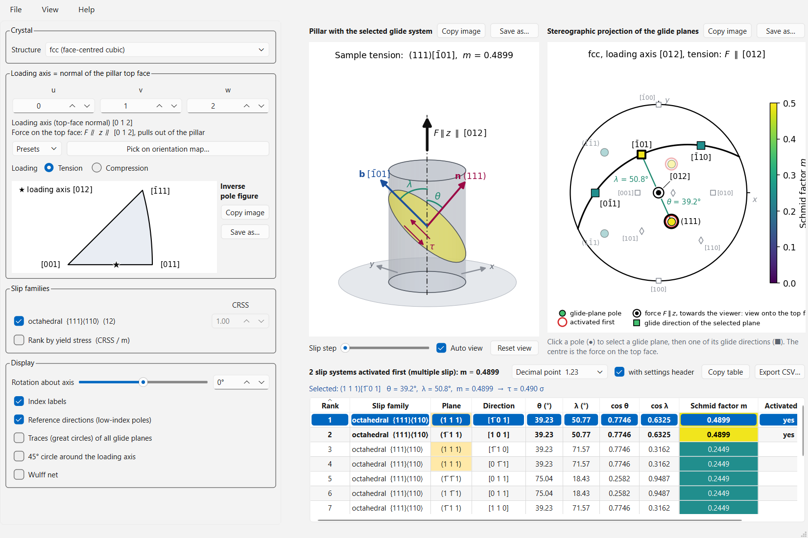

# Schmid Explorer

Teaching tool for Schmid's law. A single-crystal pillar is pulled or compressed along a chosen
crystal direction, the normal of its flat top face; the program lists every glide system of the
crystal with its Schmid factor *m* = cos θ · cos λ, shows the glide planes in a stereographic
projection centred on the direction of the force and sketches the selected glide plane and slip
direction in the pillar.



## Download and start

**Windows (no Python needed)**

1. Open the [latest release](../../releases/latest) and download `SchmidExplorer-<version>-windows.zip`.
2. Unpack the whole archive (right click → *Extract all…*); the program does not start from inside the zip.
3. Start `SchmidExplorer.exe` in the folder `SchmidExplorer`.

At the first start Windows may show *"Windows protected your PC"*, because the program carries no
paid publisher signature. Click *More info → Run anyway*.

**macOS, Linux, or Windows with Python (≥ 3.10)**

Download the source code (*Code → Download ZIP* or `git clone`), then in the folder:

```
pip install numpy matplotlib PySide6
python run_schmid_explorer.py
```

**Documentation**

The help window of the program (F1) explains the most important points; the complete theory, the
conventions and worked examples are in
[docs/SchmidExplorer_Documentation.pdf](docs/SchmidExplorer_Documentation.pdf), which is also in the
folder of the Windows download.

## What the program does

- Crystal structures: fcc, bcc, hcp (any c/a) with selectable slip families
- Loading axis as [uvw], [uvtw] or as the plane (hkil) of the pillar top face; tension or compression
- Everything is described as seen from the force **F** on the top face: the sample axis z and the
  centre of the projection point along **F** (out of the top face in tension, into the pillar in
  compression), and the plane normal **n** and the slip direction **b** (displacement of the part of
  the pillar carrying the top face) lie in the hemisphere of **F**. Switching between tension and
  compression turns the x-y-z frame by half a turn about y and reverses the indices of every plane
  and slip direction; angles, Schmid factors and ranking stay
- Small inverse pole figure below the loading axis: the axis in the standard triangle of the crystal
  ([001]–[011]–[-111], for hcp [0001]–[2-1-10]–[10-10]), with the equivalent direction inside the
  triangle if the entered one lies outside
- Ranked table of all slip systems, "activated first" flags, optional CRSS per slip family
- Orientation map (highest Schmid factor over all loading directions) to pick the loading axis
- Every figure can be copied or saved (PNG, SVG, PDF); the table can be copied or exported as CSV
- Built-in help window (F1) with the theory, the conventions, the window and examples

Author: Prof. B. Merle, University of Kassel – [www.uni-kassel.de/go/mbm](https://www.uni-kassel.de/go/mbm)

## Licence

Copyright (C) 2026 Benoit Merle, University of Kassel.

Schmid Explorer is free software: you can redistribute it and/or modify it under the terms of the
GNU General Public License as published by the Free Software Foundation, either version 3 of the
License, or (at your option) any later version. It is distributed in the hope that it will be
useful, but WITHOUT ANY WARRANTY; without even the implied warranty of MERCHANTABILITY or FITNESS
FOR A PARTICULAR PURPOSE. See [LICENSE](LICENSE).

The program is built on Python, Qt 6 with PySide6 (LGPL-3.0), NumPy and Matplotlib; the complete
list with versions and licences is in [THIRD_PARTY_LICENSES.md](THIRD_PARTY_LICENSES.md) and under
*Help → Licence and acknowledgements*. When you pass the executable on, pass on the whole folder
`SchmidExplorer` (it contains `LICENSE.txt` and the folder `licenses`) and point to this repository
or offer the source archive `SchmidExplorer-<version>-source.zip` with it.

## Layout of the code

| Folder | Content | Depends on |
|---|---|---|
| `schmid_explorer/core` | the science: lattices, symmetry, slip systems, Schmid factors, projection, pillar geometry, standard triangle, orientation map, export | numpy |
| `schmid_explorer/plotting` | the four figures (projection, pillar, inverse pole figure, orientation map), shared by the program and the documentation | matplotlib |
| `schmid_explorer/gui` | windows, widgets and wiring only – no formulas | PySide6 |
| `tests` | pytest suite, including reference values of lecture examples and a cross-check against the formulation of pycotem | pytest |
| `docs` | `build_docs.py` creates the PDF documentation with its figures | reportlab |
| `packaging` | PyInstaller recipe for the Windows executable, collection of the third-party licence texts, source and download archives | pyinstaller |

## For developers

```
pip install -r requirements.txt  # program + test, documentation and packaging tools
python -m pytest                 # run the tests
python docs/build_docs.py        # rebuild the documentation after every change of the program
python packaging/collect_licenses.py    # refresh THIRD_PARTY_LICENSES.md (versions of the installed packages)
powershell -ExecutionPolicy Bypass -File packaging/build_exe.ps1     # build dist/SchmidExplorer + archives
```

`build_exe.ps1` leaves the two files for a release in `dist`: `SchmidExplorer-<version>-windows.zip`
(executable with the PDF documentation) and `SchmidExplorer-<version>-source.zip`.

The calculation can also be used without the GUI:

```python
from schmid_explorer.core.schmid import Loading, analyse

analysis = analyse("fcc", Loading((0, 1, 2)))
for r in analysis.results:
    print(r.rank, r.plane, r.direction, round(r.m, 4), r.primary)
```
